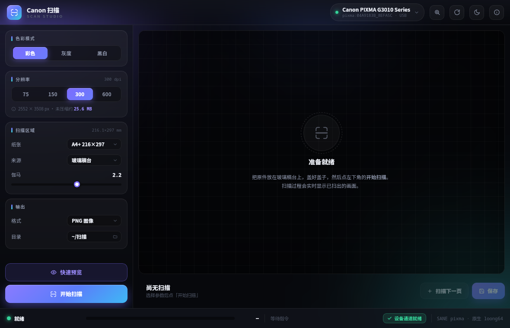

# scangearmp2 - native scanning for Canon PIXMA all-in-ones on loong64



Native USB and network scanning for Canon PIXMA / MAXIFY multifunction printers
on LoongArch (loong64).

## What's inside

- **canon-scanner-native** (driver layer): USB channel recovery `canon-scan-fix`,
  network discovery `canon-net-discover`, CLI entry `canon-scan`
- **canon-scan-studio** (the "Canon Scan" GUI): WebKitGTK front-end backed by a Python
  standard-library HTTP server; USB via SANE pixma, network via Canon's private
  CHMP channel (`/canon/ij/command2/port3`)

## Build & install

```bash
cd canon-scanner-native && bash make-deb.sh    # -> packages/
cd canon-scan-studio   && bash make-deb.sh
sudo apt install ../packages/canon-*.deb
```

## Docs

The full user manual lives in each package's `data/README.zh-CN.md`; the network
scan protocol is documented in the header of `canon-scan-studio/src/canon_scan_net.py`.

License: GPL-2.0-or-later. The full text is in [`LICENSE`](LICENSE); file-level
provenance (自研实现 / 接口事实来源 / 数据表) is in [`NOTICE.md`](NOTICE.md).