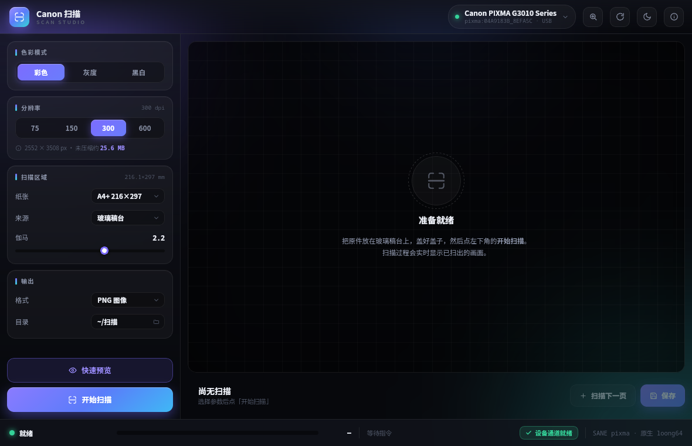

# scangearmp2 —— Canon PIXMA 一体机 · loong64 原生扫描方案



USB 与网络双通道扫描，LoongArch 原生（loong64）。

## 组成

- **canon-scanner-native**（驱动层）：USB 通道复位 `canon-scan-fix`、网络发现
  `canon-net-discover`、CLI 入口 `canon-scan`
- **canon-scan-studio**（图形应用「Canon 扫描」）：WebKitGTK 前端 + Python 标准库
  后端；USB 走 SANE pixma，网络走 Canon 私有 CHMP 通道
  （`/canon/ij/command2/port3`）

## 安装

```bash
cd canon-scanner-native && bash make-deb.sh    # → packages/
cd canon-scan-studio   && bash make-deb.sh
sudo apt install ../packages/canon-*.deb
```

## 文档

每包 `data/README.zh-CN.md` 为完整手册；网络扫描协议见
`canon-scan-studio/src/canon_scan_net.py` 头注。

许可：GPL-2.0-or-later。